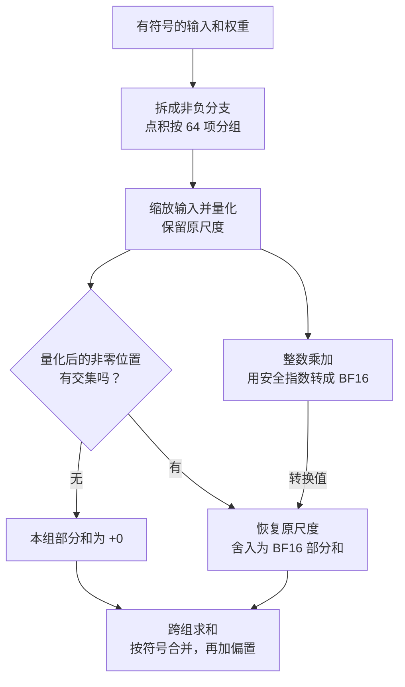
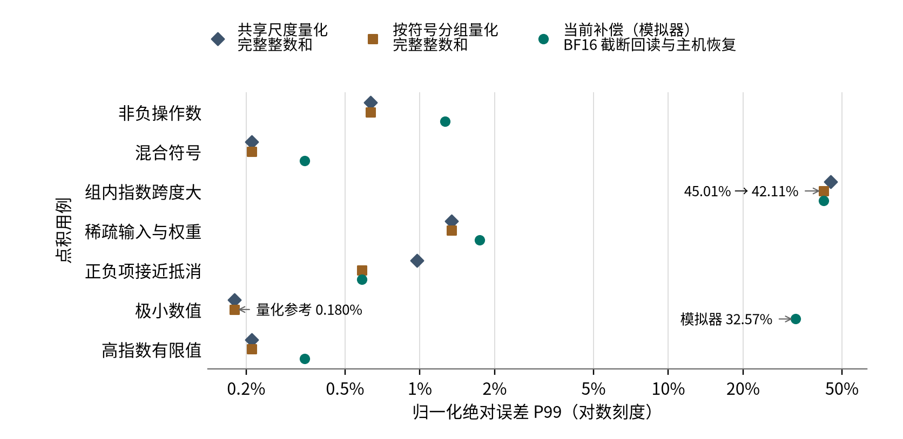

# BF16 sign-split 补偿：原理与实现

64 项输入全为 1，权重全为 0.5，点积应为 32，BF16 也能精确表示 32。但在存内计算（CIM）的原始路径上，把整数累加结果转回 BF16 时，中间指数会达到 265，超出 BF16 有限值的编码范围。补偿方法把有符号计算拆成若干非负点积，让芯片在安全的指数范围内完成转换，再由主机恢复每个点积的尺度并按符号合并。

## 数学原理

图中左路判断整数点积是否为零，右路提供尺度恢复所需的数值。左路检查的是量化后的整数，USB 后端仍会提交芯片计算并读取结果。



### 把符号留到最后处理

记输入为 $`x`$，权重为 $`W`$。下标 $`+`$ 和 $`-`$ 分别表示正、负两部分的幅值。以输入为例，$`x_+`$ 保留正数，$`x_-`$ 取负数的绝对值，其余位置各自填零。下式逐元素取最大值，两部分相减即可还原原值。

```math
W_+=\max(W,0),\quad W_-=\max(-W,0),\qquad
x_+=\max(x,0),\quad x_-=\max(-x,0).
```

令 $`F(W,x)`$ 表示不含偏置的线性层或卷积。它对权重和输入分别是线性的，因此可以展开成四项。同号的两项加上，异号的两项减去，偏置 $`b`$ 在合并后加一次。

```math
F(W,x)+b=F(W_+,x_+)-F(W_-,x_+)-F(W_+,x_-)+F(W_-,x_-)+b.
```

每一项都只用非负操作数，避开原有对齐方式在舍去低位时对负数造成的失真。已知输入恒为非负时，只需要前两项，即 $`F(W_+,x)-F(W_-,x)`$，再加偏置。

### 每组 64 项共用一个尺度

以下只看一个输出通道的一组非负点积。

| 符号          | 含义                                                                                                                                      |
| ------------- | ----------------------------------------------------------------------------------------------------------------------------------------- |
| $`i`$       | 组内位置，编号从 0 到 63。                                                                                                                |
| $`x_i,w_i`$ | 位置 $`i`$ 上转成 BF16 后的非负输入和权重。                                                                                             |
| $`E_x`$     | 非零输入组的有效指数。取组内最大输入的以 2 为底的对数，向下取整后加 127，即 $`\lfloor\log_2\max_i x_i\rfloor+127`$，范围为 −6 至 254。 |
| $`E_w`$     | 这 64 项权重的最大 BF16 指数域，范围为 0 至 254。                                                                                         |
| $`S_x,S_w`$ | 输入组与权重组各自的量化步长。                                                                                                            |
| $`a_i,b_i`$ | 位置 $`i`$ 上量化后的输入整数和权重整数。                                                                                               |
| $`p`$       | 这 64 对整数的点积。                                                                                                                      |

输入和权重分别除以各自的步长，再用 $`\lfloor\,\rfloor`$ 向下取整。指数中的 $`133=127+6`$ 来自 BF16 指数偏置和整数幅值的 6 位小数尺度。

```math
S_x=2^{E_x-133},\qquad S_w=2^{E_w-133},\qquad
a_i=\lfloor x_i/S_x\rfloor,\qquad b_i=\lfloor w_i/S_w\rfloor,\qquad
p=\sum_{i=0}^{63} a_i b_i.
```

BF16 的指数段和尾数段都为零时才表示零，符号位区分 +0 和 −0。指数段为零、尾数段非零的值是非正规数。权重全为非正规数或零时，$`E_w=0`$，量化整数直接取各项尾数段的值，步长为 $`2^{-133}`$。如果输入最大值是尾数段为 $`m`$ 的非正规数，其有效指数为 $`E_x=\lfloor\log_2 m\rfloor-6`$。输入全零时，各项整数都为零，可以直接跳过求有效指数。

记 $`x'_i`$ 为缩放并舍入后的 BF16 输入。$`\mathrm{RNE}_{\mathrm{BF16}}`$ 表示舍入到最近的 BF16 值，恰在中点时取偶数。组内统一乘以 $`2^{127-E_x}`$，使最大值落在 $`[1,2)`$，转换器使用的输入指数固定为 127。

```math
x'_i=\mathrm{RNE}_{\mathrm{BF16}}\!\left(x_i2^{127-E_x}\right).
```

缩放后的量化步长为 $`2^{-6}`$。能量化为非零整数的输入项在缩放时可以精确表示；缩放时发生下溢舍入的项原本就低于这个步长，量化后为零。

### 分别处理零值和非零值

由于乘积项都非负，只要有一个位置的输入和权重整数同时非零，点积就大于零。检查两边非零位置是否有交集，便能确定整数点积是否为零。下式用 $`\cap`$ 表示交集，用 $`\varnothing`$ 表示空集。

```math
p=0\quad\Longleftrightarrow\quad
\{i:a_i\ne0\}\cap\{i:b_i\ne0\}=\varnothing.
```

这一步用的是量化后的整数。原本非零的输入也可能因低于量化步长而变成零。在下述安全指数配置下，$`p=0`$ 和 $`p=128`$ 的转换结果都是 `0x4000`。因此由交集决定是否写入 +0，有交集时才用转换结果恢复尺度。

每个整数幅值最多为 127，非零点积的范围如下，仍在 21 位有符号整数的表示范围内。

```math
1\le p\le 64\times127^2=1{,}032{,}256<2^{20}.
```

转换器用 $`E'_w=0`$ 作为权重指数，用 $`E'_i=127`$ 作为整组输入的指数。原权重指数 $`E_w`$ 用于恢复尺度。对非零点积，$`h=\lfloor\log_2 p\rfloor`$ 是最高有效位的位置，从 0 开始计数。记转换结果的 BF16 指数域为 $`E_c`$。

```math
E_c=E'_w+E'_i+1+(h-7)=121+h\in[121,140].
```

这段指数范围对应有限的正规 BF16 数，因而转换阶段可以避开指数夹断。

### 恢复原尺度

INT21 累加结果转为 BF16 时，转换器将非零幅值的最高位对齐到正规 BF16 的隐含前导 1，并用指数记录移位后的量级。正规 BF16 只有 8 个有效位，即隐含的 1 和存储的 7 位尾数。整数幅值超过 8 个有效位时，低位无法全部保留。

当前实现直接截断低位。芯片团队提供的 RTL 派生模型和能够区分截断与最近偶数舍入的历史板卡回包都支持这一规则。

$`r=\max(h-7,0)`$ 是舍弃的低位数，$`Q(p)=\lfloor p/2^r\rfloor 2^r`$ 是将这些低位置零后的整数。安全指数配置下，芯片返回的 BF16 数值记为 $`c=Q(p)/64`$。恢复原尺度并舍入为 BF16 后，这一组的部分和记为 $`\widehat t`$。

```math
\widehat t=\mathrm{RNE}_{\mathrm{BF16}}\!\left(c\,2^{E_w+E_x-260}\right)
=\mathrm{RNE}_{\mathrm{BF16}}\!\left(Q(p)S_wS_x\right).
```

恢复式中的常数 $`260=2\times133-6`$ 来自两边的量化步长和芯片返回值中的 $`1/64`$。开头的例子里，$`E_x=127`$、$`E_w=126`$，每对整数都是 $`a_i=b_i=64`$。累加得到 $`p=2^{18}`$，安全转换返回 $`c=4096`$，乘上 $`2^{126+127-260}`$ 后正好是 32。各组的尺度可以不同，所以要先分别恢复部分和，再跨组求和。

补偿后仍有 BF16 舍入、组内量化和转换截断误差。仅就转换截断而言，$`0\le p-Q(p)\lt 2^r`$。正负部分接近时，相减会放大相对误差，靠近神经元阈值的结果也可能受影响。极小结果可以下溢为零，超过 BF16 有限范围的部分和会报错。即使精确的最终结果有限，单个分支或跨组累加仍可能溢出。和框架原生执行逐位一致、整网中间值有限以及模型准确率，均需在对应范围内分别验证。

## 数值基准



每类用例计算 2,048 个 64 项点积，参考值是原始 BF16 操作数的精确点积。将输出的绝对误差除以各项乘积的绝对值之和，可以比较不同幅值的输入，也避免正负项抵消时用接近零的点积作分母。这个归一化尺度来自经典点积误差分析。P99 是本基准对有限样本误差分布的汇总，表示约 99% 的纳入样本误差不超过该值。分母为零时单独检查，最大误差和非有限结果在基准中另报。 [点积误差分析](https://doi.org/10.1137/030601818)

两条数学参考分别使用共享尺度和按符号分组的尺度，并保留完整整数和。当前补偿的模拟器结果包含 BF16 转换截断、主机尺度恢复及舍入。

组内指数跨度较大时，按符号分组选尺度将误差 P99 从 45.01% 降到 42.11%，模拟器实测接近分组量化参考。极小数值用例中，两条数学参考均为 0.180%，模拟器实测为 32.57%，差距主要出现在量化后的转换与尺度恢复。图中七组的当前补偿输出均为有限值。另两组范围探针分别因真实点积或单分支超出 BF16 范围而报错，单独统计。复跑方法见 [BF16 点积数值基准](../python/benchmarks/README.md#bf16-点积数值基准)。

[绘图脚本](figures/scripts/plot_bf16_dot_error.py)读取[绘图数据](figures/data/bf16-dot-error.csv)中的 P99 原始比例值。安装 Matplotlib 和 Noto Sans CJK SC 字体后，从仓库根目录运行 `python docs/figures/scripts/plot_bf16_dot_error.py` 即可重绘。

## 代码实现

编译器在 Linear 和 Conv 规范化之后、BF16 准备之前运行 `split-cim-bf16-signs`。它拆分固定权重，生成输入的非负幅值、相应计算分支和主机上的加减法。只有能静态证明输入非负时才省掉负输入的两项。比较和 `select` 将负零规范为正零，并让输入 NaN 到达运行时的检查边界。动态权重及其他不满足下沉条件的算子留在主机，INT8 走整数计算路径。生成的分支会增加计算、传输和临时缓冲开销，权重能否复用由后续资源处理决定。 [Passes.cpp](../lib/Conversion/LinalgToCIM/Passes.cpp) · [Pipelines.cpp](../lib/Compiler/Pipelines.cpp)

模拟器与 USB 运行时共用外围计算。`prepareBF16Input` 负责输入归一化和记录量化后的非零位置，`validateBF16Group` 检查准备后的权重，`hasBF16Support` 每个输出通道只检查一次交集，`restoreBF16Output` 写入 +0 或用 binary64 的 `ldexp` 恢复尺度，再舍入到 BF16。输入 NaN、Inf 和非法权重会报错，零权重分支也保留输入检查。 [BF16Compensation.cpp](../lib/Execution/BF16Compensation.cpp) · [BF16Support.cpp](../lib/Support/BF16Support.cpp)

模拟器在软件里执行整数乘加和 BF16 转换，可跳过没有交集的输出通道。USB 路径发送归一化输入与线上权重指数 0，从芯片读回 BF16 位型，再用保留的原始指数和事务信息恢复尺度。原始 `capture` 仍保留未补偿的回包。恢复后的 BF16 部分和按既有路径在 FP32 中沿点积维度（K 维）求和，经过 BF16 kernel 输出边界后再扩为 FP32 合并正负分支。分支合并后按原算子类型返回，偏置仍在原来的主机位置加一次。 [CIMSoftwareRunner.cpp](../lib/Execution/CIMSoftwareRunner.cpp) · [CIMBoardRunner.cpp](../runtime/CIMBoardRunner.cpp)

### 选择执行后端与对照策略

PyTorch 和 TensorFlow 的 `bf16_compensation` 默认都是 `sign-split`。`legacy` 仅做旧版尺度补偿，仍有符号、零值和低指数处理的局限。`none` 直接保留原始位型，包括 NaN 和 Inf。策略在编译期由模块属性 `cim.bf16_compensation` 落实为 `cim22_dispatch_sign_split`、`cim22_dispatch_legacy` 或 `cim22_dispatch`。制品通过生成的调用携带策略，加载时直接执行这些调用。 [NativeCompiler.cpp](../compiler/NativeCompiler.cpp) · [Runtime.cpp](../runtime/Runtime.cpp)

`runtime="simulator"` 和 `runtime="usb"` 都执行编译时选定的策略，USB 后端在发起 CIM 计算前需要配置板卡。PyTorch 的 `runtime="reference"` 直接执行 CPU PyTorch 算子，忽略补偿选项。TensorFlow 可直接调用原 `tf.function` 取得参考结果。 [Python 编译选项](../python/README.md#编译选项)

### 回归检查

- [软件运行时测试](../test/Unit/Execution/CIMSoftwareRunnerTest.cpp)检查 +0、−0、非正规数、整数点积 128、量化后零值、非法操作数和真实溢出。
- [USB 设备替身测试](../test/Unit/Execution/CIMDeviceRuntimeTest.cpp)检查归一化输入、线上指数、回包恢复、原始采集、多任务隔离和错误传播。
- [编译器测试](../test/Conversion/LinalgToCIM/split-cim-bf16-signs.mlir)检查分支结构、输入非负时的简化、类型边界和重复执行。相邻用例覆盖策略、诊断和完整流水线。
- [Python 集成测试](../python/tests/test_bf16_runtime.py)覆盖三种策略、缓存隔离、packet JIT、AOT 制品、新进程加载和 USB 未配置时的错误。

仓库内的 USB 回归使用设备替身，板卡数值与性能需要按实际设备和模型分别评估。
